# IM Bridge — Mattermost ⇄ Discord

> Un stack **Docker Compose** multi-services qui héberge un serveur de messagerie d'entreprise (**Mattermost**) et le relie en temps réel à **Discord** grâce à un bridge écrit sur mesure en TypeScript.

---

## 1. Le problème

Les utilisateurs sont dispersés sur plusieurs messageries concurrentes. L'entreprise utilise **Mattermost**, mais une partie des personnes reste sur **Discord** et ne veut pas changer d'outil.

**Objectif :** que chacun puisse discuter **depuis et vers** Mattermost avec son propre compte, sans quitter sa messagerie habituelle.

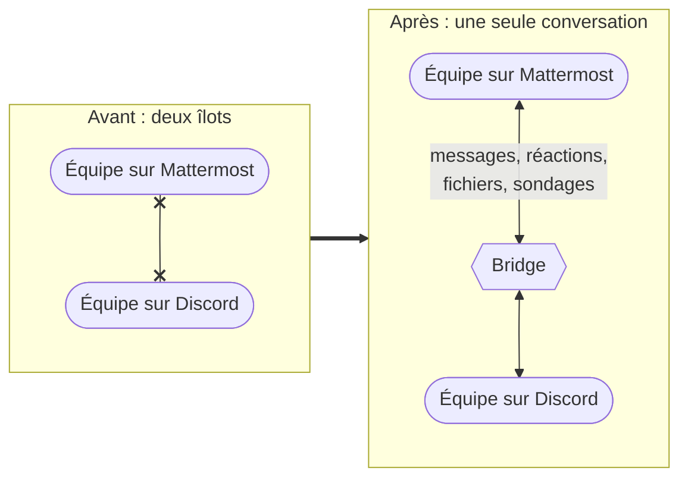

### Objectifs pédagogiques

| Thème              | Ce que le projet met en pratique                                |
| ------------------ | --------------------------------------------------------------- |
| Docker Compose     | Orchestrer 5 services qui dépendent les uns des autres                        |
| Networking         | Réseaux séparés, réseau `internal`, DNS interne, un seul port exposé          |
| Sécurité           | Secrets hors dépôt, non-root, `cap_drop`, lecture seule, isolation de la base |
| Fonctions avancées | Fragments YAML, healthchecks, multi-stage, cgroups, Compose Watch             |
| Environnement      | Variables obligatoires / par défaut, stack de dev en surcharge, profils       |
| Exploitation       | Page de statut, rotation des logs, persistance par volumes                    |

---

## 2. Vue d'ensemble de l'architecture

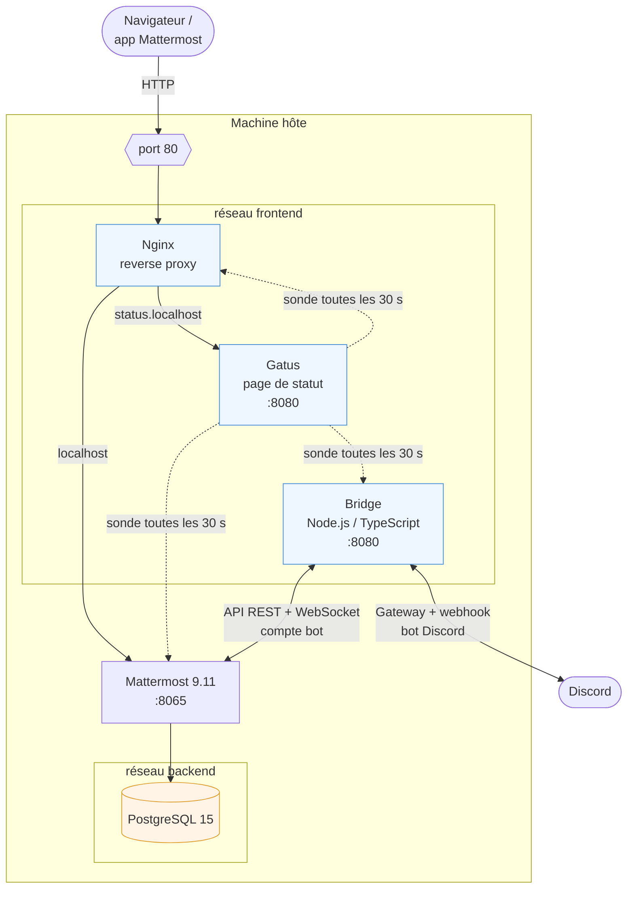

**Mattermost est le seul service présent sur les deux réseaux** : il fait le pont entre la partie exposée (frontend) et la base de données (backend).

### Les 5 services

| Service      | Image de base                                | Rôle                                                             | Réseaux            |
| ------------ | -------------------------------------------- | ---------------------------------------------------------------- | ------------------ |
| `db`         | `postgres:15-alpine`                         | Base de données de Mattermost                                    | backend            |
| `mattermost` | `mattermost-enterprise-edition:release-9.11` | Serveur de messagerie (API + WebSocket)                          | frontend + backend |
| `nginx`      | `nginx:alpine`                               | Point d'entrée unique, upgrade WebSocket, routage par nom d'hôte | frontend           |
| `bridge`     | `node:24-alpine`                             | Relais Mattermost ⇄ Discord (code maison)                        | frontend           |
| `status`     | `gatus:v5.37.0`                              | Page de statut sur `status.localhost`                            | frontend           |

---

## 3. Networking : qui peut parler à qui ?

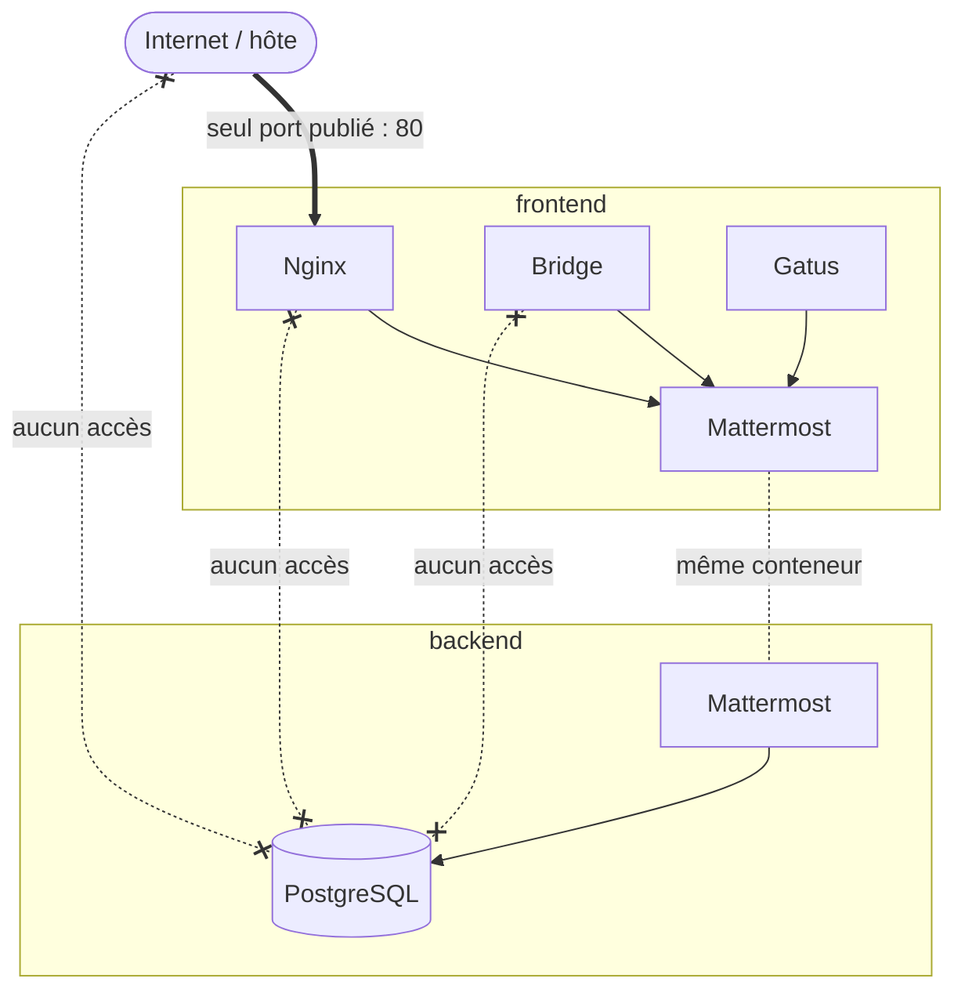

Points clés :

- **Un seul port publié sur l'hôte** (Nginx). Mattermost, le bridge et Gatus ne sont joignables que par le réseau Docker.
- **PostgreSQL est enfermé dans `backend`** : ni l'extérieur, ni Nginx, ni le bridge ne peuvent l'atteindre.
- **`backend` est un réseau `internal: true`** : aucune route vers Internet. Même compromise, la base ne peut rien exfiltrer ni télécharger.
- **DNS interne Docker** : les services s'appellent par leur nom (`mattermost:8065`, `bridge:8080`). Nginx utilise le résolveur `127.0.0.11` et re-résout l'adresse à chaque requête, pour ne pas renvoyer d'erreur 502 quand un conteneur est recréé.
- **Routage par nom d'hôte** : sur le même port 80, `localhost` → Mattermost et `status.localhost` → page de statut.

---

## 4. Démarrage ordonné par healthchecks

Chaque service attend que ses dépendances soient réellement **prêtes** (pas seulement démarrées) grâce à `depends_on: condition: service_healthy`.

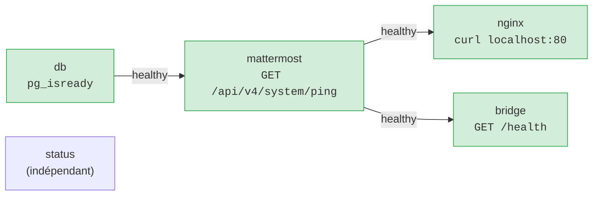

Le healthcheck du bridge renvoie **503 tant que l'une des deux connexions** (Mattermost ou Discord) est coupée : `docker compose ps` affiche donc un état fidèle à la réalité.

---

## 5. Le bridge : un service écrit pour le projet

Matterbridge (la solution habituelle) n'est plus maintenu et ne relaie ni les réactions, ni les stickers, ni les sondages. Le projet embarque donc **son propre bridge** (~1 400 lignes de TypeScript, basé sur `discord.js`).

### Architecture interne

```mermaid
flowchart TB
    index["index.ts<br/>point d'entrée, arrêt propre"]
    config["config.ts<br/>lecture et vérification du .env"]
    bridge["bridge.ts<br/>relais Discord ⇄ Mattermost"]
    polls["polls.ts<br/>sondages synchronisés"]
    mm["mattermost.ts<br/>client REST + WebSocket<br/>reconnexion automatique"]
    store["store.ts<br/>correspondance des IDs<br/>de messages"]
    http["http.ts<br/>/health + boutons de vote"]
    emoji["emoji.ts<br/>noms Mattermost ⇄ Unicode"]

    vol[("volume bridge-data<br/>/data/state.json")]
    djs[["discord.js"]]

    index --> config
    index --> bridge
    index --> http
    bridge --> polls
    bridge --> mm
    bridge --> store
    bridge --> emoji
    bridge --> djs
    polls --> store
    store --> vol
```

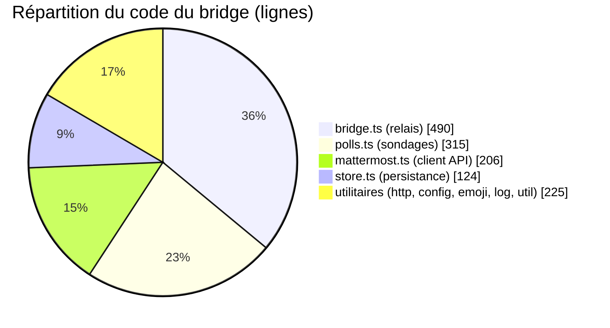

### Ce qui est relayé

| Fonctionnalité                            | Discord → Mattermost | Mattermost → Discord |
| ----------------------------------------- | :------------------: | :------------------: |
| Messages (avec pseudo + avatar d'origine) |          ✅          |          ✅          |
| Modifications / suppressions              |          ✅          |          ✅          |
| Réponses dans un fil                      |          ✅          |          ✅          |
| Réactions (ajout / retrait)               |          ✅          |          ✅          |
| Images, vidéos, fichiers                  |          ✅          |          ✅          |
| Messages vocaux                           |          ✅          |          ✅          |
| GIF (Tenor, Giphy…)                       |          ✅          |          ✅          |
| Stickers                                  |          ✅          |          —           |
| Sondages (votes croisés)                  |          ✅          |          ✅          |

---

## 6. Parcours d'un message : Discord → Mattermost

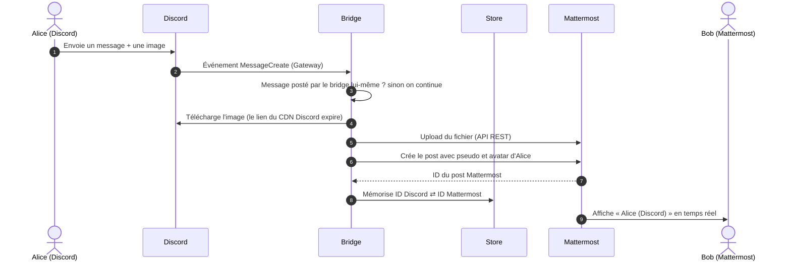

La table de correspondance des IDs (`store.ts`) est la clé de voûte : sans elle, impossible de relayer une **réponse**, une **réaction**, une **modification** ou une **suppression** sur le bon message. Elle est persistée dans un volume pour survivre aux redémarrages.

---

## 7. Parcours d'un message : Mattermost → Discord

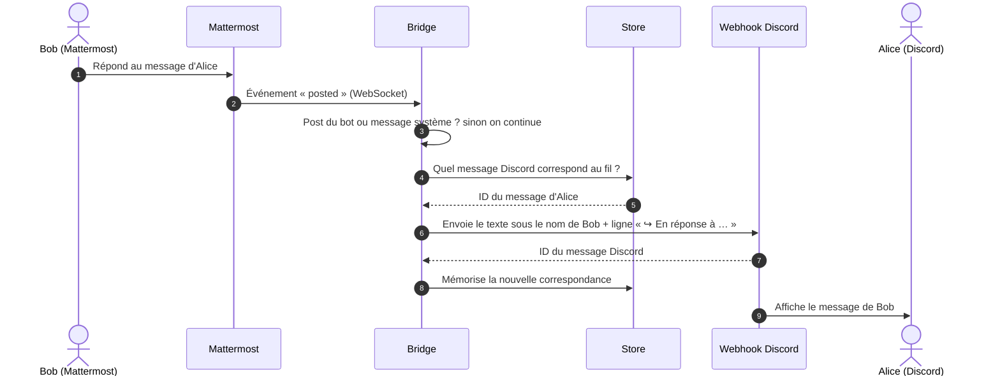

**Anti-boucle :** le bridge ignore systématiquement ses propres messages (webhook ou compte bot), sinon chaque message serait renvoyé à l'infini entre les deux plateformes.

---

## 8. Cas avancé : les sondages synchronisés

Chaque plateforme vote avec ses propres outils, et le bridge additionne les résultats.

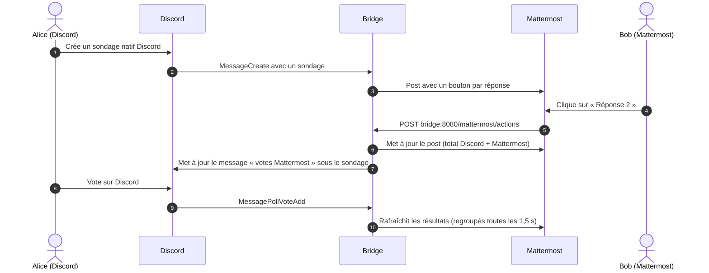

Côté Mattermost, la commande `!sondage Question ? | Réponse 1 | Réponse 2` crée un sondage natif Discord. Cet appel retour de Mattermost vers le bridge est rendu possible par `MM_SERVICESETTINGS_ALLOWEDUNTRUSTEDINTERNALCONNECTIONS=bridge`.

---

## 9. Images Docker personnalisées

Chaque service a son propre `Dockerfile` dans `mattermost/<service>/`.

### Build multi-stage du bridge

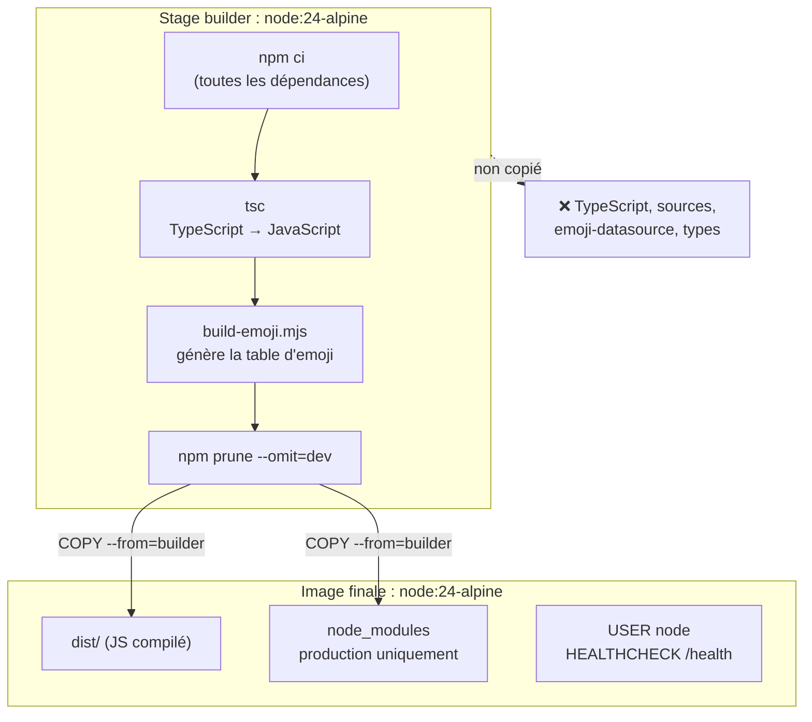

L'image finale ne contient **ni le compilateur, ni les sources, ni les dépendances de développement** : elle est plus légère et offre moins de surface d'attaque.

### Gatus : un mini multi-stage pour une image `FROM scratch`

L'image Gatus n'a pas de shell. Le dossier `/data` est préparé dans un stage Alpine puis copié avec le bon propriétaire (`nobody`), ce qui permet de faire tourner Gatus **en non-root**.

---

## 10. Fragments YAML : ne pas se répéter

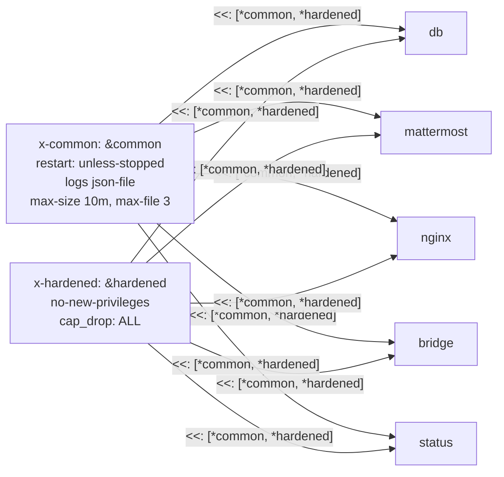

Deux blocs, fusionnés dans chaque service :

- `x-common` : politique de redémarrage et **rotation des logs** (3 fichiers de 10 Mo maximum par service) ;
- `x-hardened` : **durcissement** commun. Chaque service ne rajoute (`cap_add`) que les capabilities dont il a besoin.

---

## 11. Cgroups : chaque service dans sa boîte

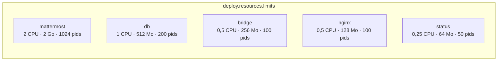

- Une fuite mémoire dans le bridge le fait redémarrer **sans faire tomber Mattermost**.
- La limite de processus bloque une fork bomb.
- Preuve en direct : `docker stats` affiche la consommation face à chaque limite.

---

## 12. Stack de développement et Compose Watch

```bash
docker compose -f docker-compose.yml -f docker-compose.dev.yml up --build --watch
```

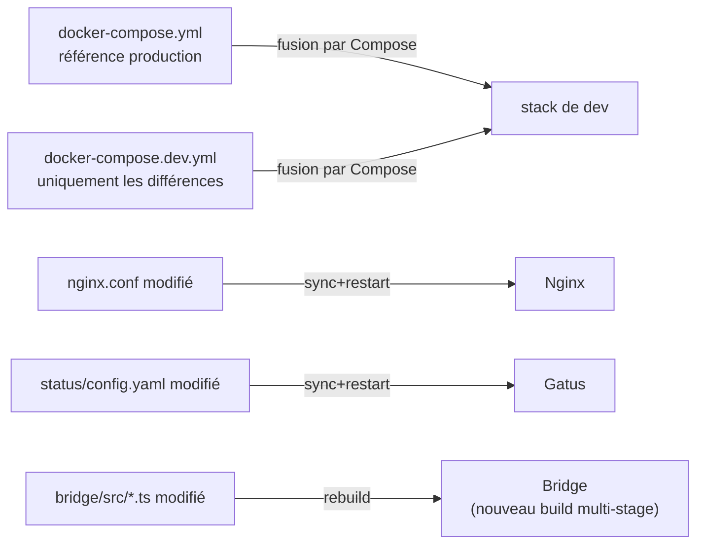

| En dev                                   | Pourquoi                                                        |
| ---------------------------------------- | --------------------------------------------------------------- |
| PostgreSQL, Mattermost, bridge exposés sur `127.0.0.1` | Outils SQL, tests d'API, `/health` ; jamais sur le réseau local |
| `backend` repasse en `internal: false`   | Docker ne publie pas les ports d'un réseau interne              |
| Logs `DEBUG`, `BRIDGE_DEBUG=true`        | Mise au point                                                    |
| Adminer avec `--profile tools`           | Outil lancé seulement à la demande                               |

---

## 13. Supervision : la page de statut

Gatus sonde les services toutes les 30 secondes et conserve l'historique (SQLite dans un volume).

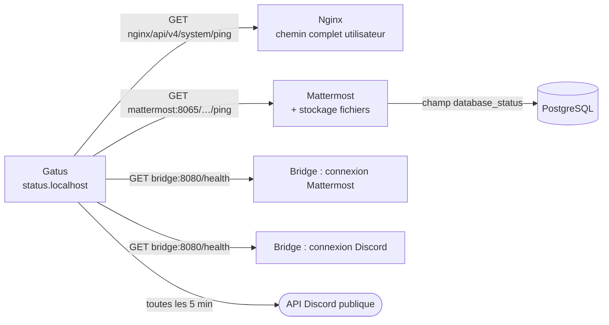

Gatus n'est que sur `frontend` : **il ne touche jamais la base**. L'état de PostgreSQL est lu indirectement, via la réponse de Mattermost.

---

## 14. Sécurité : défense en profondeur

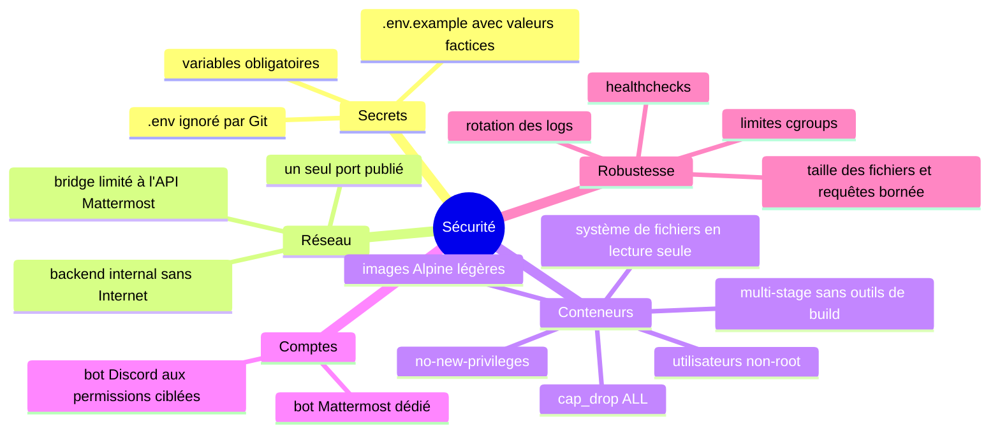

---

## 15. Persistance des données

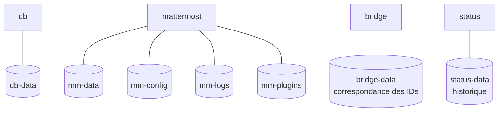

`docker compose down` conserve tout ; seul `docker compose down -v` efface les volumes.

---

## 16. Démonstration

```bash
cp .env.example .env
```

```bash
docker compose up -d --build
```

```bash
docker compose ps
```

1. Ouvrir <http://localhost> : Mattermost.
2. Ouvrir <http://status.localhost> : tous les services au vert.
3. Écrire sur Discord → le message apparaît sur Mattermost avec le pseudo et l'avatar Discord.
4. Répondre, réagir, envoyer une image depuis Mattermost → tout arrive sur Discord.
5. Lancer `!sondage Pizza ou burger ? | Pizza | Burger` et voter des deux côtés.

### Preuves en ligne de commande

| Ce qu'on prouve                     | Commande                                                          | Résultat attendu                     |
| ----------------------------------- | ----------------------------------------------------------------- | ------------------------------------ |
| Fragments et variables résolus      | `docker compose config`                                           | blocs fusionnés, chaîne de connexion construite |
| Variable obligatoire                | `POSTGRES_PASSWORD= docker compose config`                        | erreur explicite                     |
| La base n'a pas accès à Internet    | `docker compose exec db wget -T 3 http://example.com`             | `bad address`                        |
| La base n'est pas exposée           | `docker compose port db 5432`                                     | aucun port                           |
| Lecture seule et non-root           | `docker compose exec bridge sh -c 'id; touch /app/x'`             | `uid=1000(node)`, `Read-only file system` |
| Limites cgroups                     | `docker stats --no-stream`                                        | `… / 256MiB` pour le bridge          |
| Image multi-stage légère            | `docker image ls`                                                 | image du bridge sans TypeScript      |

### Démonstration de Compose Watch

```bash
docker compose -f docker-compose.yml -f docker-compose.dev.yml up --build --watch
```

Modifier `nginx.conf` (ou un fichier du bridge) : Compose affiche `Syncing service "nginx"` puis redémarre le service tout seul.

---

## 17. Bilan et perspectives

**Réalisé**

- Stack de 5 services orchestrés, démarrage ordonné par healthchecks.
- Isolation réseau frontend / backend (`internal`), un seul port exposé.
- Images personnalisées, non-root, build multi-stage, `cap_drop`, lecture seule.
- Limites cgroups (CPU, mémoire, processus) sur chaque service.
- Stack de développement en surcharge avec Compose Watch et profil `tools`.
- Bridge complet : messages, fils, réactions, fichiers, audio, GIF, stickers, sondages.
- Page de statut et persistance de l'état du bridge.

**Pistes d'amélioration**

- Passer en HTTPS (certificat sur Nginx).
- Passer les tokens en `secrets:` Docker (lecture de fichiers `*_FILE` à ajouter au bridge).
- Ajouter la visio (plugin Mattermost Calls + `rtcd`).
- Relier plusieurs salons, voire d'autres messageries (Slack, Teams…).
