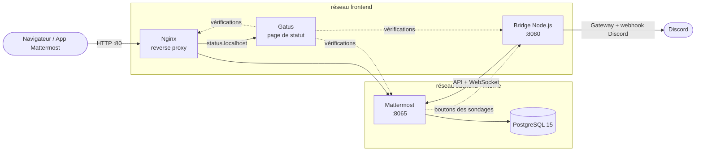

# IM Bridge - Mattermost ⇄ Discord

Stack Docker Compose qui déploie un serveur **Mattermost** (messagerie) et un **bridge vers Discord**, afin que les utilisateurs présents sur Discord puissent échanger avec ceux de Mattermost sans changer d'outil.

---

## Sommaire

- [Contexte](#contexte)
- [Architecture](#architecture)
- [Services](#services)
- [Démarrage rapide](#démarrage-rapide)
- [Variables d'environnement](#variables-denvironnement)
- [Configurer le bridge Discord](#configurer-le-bridge-discord)
- [Page de statut](#page-de-statut)
- [Stack de développement](#stack-de-développement)
- [Fonctionnalités Docker avancées](#fonctionnalités-docker-avancées)
- [Sécurité](#sécurité)
- [Structure du projet](#structure-du-projet)
- [Commandes utiles](#commandes-utiles)
- [Correspondance avec l'énoncé](#correspondance-avec-lénoncé)

---

## Contexte

Les utilisateurs sont répartis sur plusieurs services de messagerie de groupe concurrents. L'objectif est de leur permettre de communiquer **depuis et vers** le service de l'entreprise (Mattermost) à partir de leur compte sur un autre service (Discord).

Objectifs pédagogiques :

- comprendre et tester Docker / Docker Compose sur un projet multi-services ;
- étudier les possibilités de networking offertes par Docker ;
- sécuriser les images et le stack applicatif ;
- utiliser des fonctionnalités avancées (Watch, fragments, cgroups, multi-stage, healthchecks) ;
- proposer un environnement de développement / configuration distinct de la production.

---

## Architecture



Principes :

- **Seul Nginx expose un port** sur l'hôte. Mattermost et PostgreSQL ne sont joignables que depuis les réseaux Docker.
- **PostgreSQL n'est attaché qu'au réseau `backend`** : il n'est accessible ni depuis l'extérieur, ni depuis Nginx, ni depuis le bridge.
- **Le bridge** parle à Mattermost via son API (compte bot dédié) et à Discord via un bot Discord. Il n'a jamais accès à la base de données.
- Le démarrage est ordonné par des **healthchecks** : `db` → `mattermost` → `nginx` / `bridge`.

---

## Services

| Service      | Image de base                                           | Rôle                                                    | Réseaux                  |
| ------------ | ------------------------------------------------------- | ------------------------------------------------------- | ------------------------ |
| `db`         | `postgres:15-alpine`                                    | Base de données de Mattermost                           | `backend`                |
| `mattermost` | `mattermost/mattermost-enterprise-edition:release-9.11` | Serveur de messagerie (API + WebSocket sur `:8065`)     | `frontend`, `backend`    |
| `nginx`      | `nginx:alpine`                                          | Reverse proxy, point d'entrée unique, upgrade WebSocket | `frontend`               |
| `bridge`     | `node:24-alpine` (bridge maison en TypeScript)          | Relais Mattermost ⇄ Discord (messages, réactions, fichiers, sondages…) | `frontend` |
| `status`     | `twinproduction/gatus:v5.37.0`                          | Page de statut des services, servie sur `http://status.localhost` | `frontend` |

Volumes persistants : `db-data`, `mm-data`, `mm-config`, `mm-logs`, `mm-plugins`, `bridge-data` (correspondance des IDs de messages entre les deux plateformes), `status-data` (historique de la page de statut).

---

## Démarrage rapide

### Prérequis

- Docker Engine ≥ 24 et Docker Compose v2 (`docker compose`, pas `docker-compose`)
- Un serveur Discord sur lequel vous êtes administrateur (pour le bridge)

### Installation

1. Cloner le dépôt puis copier le fichier d'exemple des variables d'environnement :

```bash
cp .env.example .env
```

2. Éditer `.env` et remplacer au minimum les valeurs `change_me` (voir [Variables d'environnement](#variables-denvironnement)).

3. Construire et lancer le stack :

```bash
docker compose up -d --build
```

4. Vérifier que tous les services sont `healthy` :

```bash
docker compose ps
```

5. Ouvrir <http://localhost> (ou le port défini dans `NGINX_PORT`), créer le compte administrateur et la première équipe Mattermost.

6. L'état des services est visible sur <http://status.localhost> (voir [Page de statut](#page-de-statut)).

---

## Variables d'environnement

Toute la configuration passe par le fichier `.env` (jamais versionné). Le fichier [`.env.example`](.env.example) sert de modèle. Le compose utilise trois formes d'interpolation :

| Syntaxe              | Effet                                                                        | Utilisée pour                          |
| -------------------- | ---------------------------------------------------------------------------- | -------------------------------------- |
| `${VAR:?message}`    | Variable **obligatoire** : `docker compose` refuse de démarrer et affiche le message | Identifiants PostgreSQL         |
| `${VAR:-défaut}`     | Valeur par défaut si la variable est absente ou vide                          | Port, URL, version, options du bridge  |
| `${A}:${B}@…`        | Valeur **construite** à partir d'autres variables                             | Chaîne de connexion de Mattermost      |

### PostgreSQL (obligatoires)

| Variable            | Description             | Exemple      |
| ------------------- | ----------------------- | ------------ |
| `POSTGRES_USER`     | Utilisateur de la base  | `mmuser`     |
| `POSTGRES_PASSWORD` | Mot de passe de la base | `change_me`  |
| `POSTGRES_DB`       | Nom de la base          | `mattermost` |

### Mattermost

Mattermost lit directement les variables préfixées `MM_` pour surcharger sa configuration (format `MM_<SECTION>_<CLÉ>`).

| Variable                     | Description                                         | Défaut             |
| ---------------------------- | --------------------------------------------------- | ------------------ |
| `MM_SERVICESETTINGS_SITEURL` | URL publique du serveur                             | `http://localhost` |
| `MATTERMOST_VERSION`         | Tag de l'image Mattermost (argument de build)       | `release-9.11`     |

La chaîne de connexion `MM_SQLSETTINGS_DATASOURCE` est **construite par le compose** à partir des trois variables PostgreSQL : le mot de passe n'est saisi qu'une fois. Comme il est placé dans une URL, il ne doit pas contenir `@`, `/`, `:` ni `#`. D'anciennes lignes `MM_SQLSETTINGS_DRIVERNAME` / `MM_SQLSETTINGS_DATASOURCE` dans `.env` sont simplement ignorées.

Quatre réglages nécessaires au bridge sont fixés directement dans `docker-compose.yml` (ils ne sont donc plus modifiables depuis la console système) :

| Variable                                               | Rôle                                                           |
| ------------------------------------------------------ | -------------------------------------------------------------- |
| `MM_SERVICESETTINGS_ENABLEPOSTUSERNAMEOVERRIDE=true`   | Afficher le pseudo Discord de l'auteur                         |
| `MM_SERVICESETTINGS_ENABLEPOSTICONOVERRIDE=true`       | Afficher l'avatar Discord de l'auteur                          |
| `MM_SERVICESETTINGS_ENABLELINKPREVIEWS=true`           | Aperçu des liens, dont les GIF Tenor/Giphy envoyés depuis Discord |
| `MM_SERVICESETTINGS_ALLOWEDUNTRUSTEDINTERNALCONNECTIONS=bridge` | Autoriser Mattermost à appeler le bridge (boutons des sondages) |

### Nginx

| Variable     | Description                     | Défaut |
| ------------ | ------------------------------- | ------ |
| `NGINX_PORT` | Port exposé sur la machine hôte | `80`   |

### Bridge Discord

| Variable               | Description                                |
| ---------------------- | ------------------------------------------ |
| `DISCORD_TOKEN`        | Token du bot Discord                       |
| `DISCORD_SERVER`       | ID (ou nom) du serveur Discord à relier    |
| `DISCORD_CHANNEL`      | Salon Discord relié (ex. `general`)        |
| `MATTERMOST_BOT_TOKEN` | Token d'accès du compte bot Mattermost     |
| `MATTERMOST_TEAM`      | Nom de l'équipe Mattermost                 |
| `MATTERMOST_CHANNEL`   | Canal Mattermost relié (ex. `town-square`) |

Ces variables sont facultatives pour Compose (`${VAR:-}`) : le token du bot Mattermost n'existe qu'une fois Mattermost installé, le stack doit donc pouvoir démarrer sans lui. Le bridge vérifie lui-même leur présence au démarrage et s'arrête avec un message clair s'il en manque.

Variables optionnelles : `BRIDGE_DEBUG=true` (logs détaillés, `false` par défaut), `TZ` (fuseau des dates affichées dans les sondages, `Europe/Paris` par défaut).

---

## Configurer le bridge Discord

Le bridge est un service Node.js / TypeScript écrit pour ce projet ([`mattermost/bridge/src`](mattermost/bridge/src)), basé sur [discord.js](https://discord.js.org) et l'API REST + WebSocket de Mattermost. Il remplace Matterbridge, qui n'est plus maintenu et ne relaie ni les réactions, ni les stickers, ni les sondages. Au démarrage, il vérifie que les variables du `.env` sont renseignées : les secrets ne sont jamais écrits dans le dépôt.

Le bridge parle directement à `mattermost:8065` via le réseau `frontend` ; il n'a pas accès au réseau `backend` (base de données). Il expose le port `8080` sur ce réseau uniquement (healthcheck et boutons de vote), sans le publier sur l'hôte.

### Ce qui est relayé

| Fonctionnalité         | Discord → Mattermost                                                         | Mattermost → Discord                                                                  |
| ---------------------- | ---------------------------------------------------------------------------- | ------------------------------------------------------------------------------------- |
| Messages               | ✅ avec le pseudo et l'avatar Discord                                         | ✅ via webhook, avec le pseudo Mattermost                                              |
| Modifications / suppressions | ✅                                                                     | ✅                                                                                     |
| Réponses               | ✅ réponse dans le fil du message cité                                        | ✅ ligne « ↪ En réponse à … » avec lien vers le message (les webhooks Discord ne peuvent pas répondre nativement) |
| Réactions              | ✅ ajout et retrait (portées par le bot Mattermost)                           | ✅ ajout et retrait (portées par le bot Discord)                                       |
| Images, vidéos, fichiers | ✅ ré-uploadés dans Mattermost (les liens du CDN Discord expirent), jusqu'à 50 Mo | ✅ ré-uploadés dans Discord, dans la limite du serveur (10 Mo, 50/100 Mo selon les boosts) |
| Messages audio         | ✅ message vocal ré-uploadé en `.ogg` avec sa durée                           | ✅ fichier audio ; un fichier Ogg/Opus seul devient un message vocal Discord            |
| GIF                    | ✅ lien Tenor/Giphy avec aperçu, ou fichier GIF ré-uploadé                     | ✅ les GIF du sélecteur Mattermost sont envoyés en lien et intégrés par Discord        |
| Stickers               | ✅ image du sticker (PNG/APNG/GIF) ; nom seul pour les stickers animés Lottie | — (Mattermost n'a pas de stickers)                                                    |
| Sondages               | ✅ sondage natif → post avec boutons de vote, résultats mis à jour en direct  | ✅ `!sondage Question ? \| Réponse 1 \| Réponse 2` crée un sondage natif Discord (24 h, `!sondage+` pour plusieurs réponses) |

Pour les sondages, chaque côté vote avec ses propres outils (sondage natif sur Discord, boutons sur Mattermost) : le post Mattermost affiche le total des deux, et un message sous le sondage Discord affiche les votes venus de Mattermost.

Limites connues : une réaction relayée apparaît au nom du bot et non de l'utilisateur d'origine ; les emoji personnalisés ne passent que s'ils existent sous le même nom des deux côtés.

### 1. Créer le bot Discord

1. Aller sur le [Discord Developer Portal](https://discord.com/developers/applications) → **New Application**.
2. Onglet **Bot** → **Reset Token** et copier le token dans `DISCORD_TOKEN`.
3. Activer **Message Content Intent**.
4. Onglet **OAuth2 → URL Generator** : cocher `bot`, puis les permissions _View Channels_, _Send Messages_, _Read Message History_, _Add Reactions_, _Attach Files_, _Embed Links_, _Manage Webhooks_ (obligatoire : affichage du pseudo Mattermost) et _Manage Messages_ (optionnel : relayer sur Discord la suppression d'un message Discord faite depuis Mattermost).
5. Ouvrir l'URL générée et inviter le bot sur votre serveur.
6. Récupérer l'ID du serveur (mode développeur Discord → clic droit sur le serveur → _Copier l'identifiant_) dans `DISCORD_SERVER`.

### 2. Créer le bot Mattermost

1. **Console système → Intégrations → Comptes bot** : activer la création de comptes bot.
2. **Intégrations → Comptes bot → Ajouter** : créer un bot (ex. `discord-bridge`) et copier son token dans `MATTERMOST_BOT_TOKEN`.
3. Ajouter le bot à l'équipe et au canal à relier.

### 3. Relancer le bridge

```bash
docker compose up -d bridge
```

```bash
docker compose logs -f bridge
```

Un message posté dans le canal Mattermost doit apparaître dans le salon Discord, et inversement. Les logs indiquent `Mattermost : WebSocket connecté` et `Discord : connecté en tant que …` ; `docker compose ps` affiche le bridge `healthy` quand les deux connexions sont établies.

---

## Page de statut

Le service `status` ([Gatus](https://github.com/TwiN/gatus)) vérifie les services toutes les 30 secondes et affiche leur état et leur historique sur <http://status.localhost>. Nginx le sert sur le même port 80 que Mattermost, en se basant sur le nom d'hôte : les navigateurs résolvent `*.localhost` vers la machine locale, sans rien configurer. Les vérifications sont décrites dans [`mattermost/status/config.yaml`](mattermost/status/config.yaml).

| Vérification                   | Comment                                                                          |
| ------------------------------ | -------------------------------------------------------------------------------- |
| Nginx (point d'entrée)         | `GET http://nginx/api/v4/system/ping` : chemin complet Nginx → Mattermost         |
| Mattermost                     | `GET /api/v4/system/ping?get_server_status=true` : serveur et stockage de fichiers |
| PostgreSQL                     | Champ `database_status` de cette même réponse                                     |
| Bridge — connexion Mattermost  | `GET http://bridge:8080/health` → `mattermost: true` (WebSocket ouvert)           |
| Bridge — connexion Discord     | `GET http://bridge:8080/health` → `discord: true` (gateway connectée)             |
| API Discord                    | `GET https://discord.com/api/v10/gateway`, toutes les 5 minutes                   |

La page de statut n'est attachée qu'au réseau `frontend` : elle n'a pas accès à la base de données, dont l'état est lu à travers Mattermost.

---

## Stack de développement

Le fichier [`docker-compose.dev.yml`](docker-compose.dev.yml) est une **surcharge** : Compose fusionne les deux fichiers, la production reste la référence et le fichier dev ne contient que les différences.

Lancer le stack de dev (Compose Watch actif) :

```bash
docker compose -f docker-compose.yml -f docker-compose.dev.yml up --build --watch
```

Ajouter Adminer, une interface web pour PostgreSQL (profil `tools`) :

```bash
docker compose -f docker-compose.yml -f docker-compose.dev.yml --profile tools up --build --watch
```

### Compose Watch

| Fichier modifié                          | Action          | Effet                                                         |
| ---------------------------------------- | --------------- | ------------------------------------------------------------- |
| `mattermost/nginx/nginx.conf`            | `sync+restart`  | Copié dans le conteneur Nginx, puis Nginx redémarre            |
| `mattermost/status/config.yaml`          | `sync+restart`  | Nouvelle configuration de la page de statut                    |
| `mattermost/bridge/src/`, `package.json`, `scripts/` | `rebuild` | TypeScript compilé : nouveau build multi-stage et conteneur recréé |

`sync` écrit dans le conteneur : Nginx et Gatus repassent donc en `read_only: false` en dev.

### Autres différences avec la production

| Élément                 | Production                    | Développement                                                   |
| ----------------------- | ----------------------------- | --------------------------------------------------------------- |
| Réseau `backend`        | `internal: true`              | `internal: false` : Docker ne publie pas les ports d'un conteneur qui n'est que sur un réseau interne |
| PostgreSQL              | non exposé                    | `127.0.0.1:5432` (`DEV_DB_PORT`)                                 |
| Mattermost              | uniquement via Nginx          | aussi en direct sur `127.0.0.1:8065` (`DEV_MATTERMOST_PORT`)     |
| Bridge                  | non exposé                    | `127.0.0.1:8080/health` (`DEV_BRIDGE_PORT`), `BRIDGE_DEBUG=true` |
| Logs Mattermost         | niveau par défaut             | `DEBUG`                                                          |
| Adminer                 | absent                        | `127.0.0.1:8081` avec `--profile tools` (`DEV_ADMINER_PORT`)     |

Les ports de dev ne sont liés qu'à `127.0.0.1` : ils ne sont pas joignables depuis le réseau local. Les limites de ressources sont conservées, pour développer dans les mêmes conditions qu'en production.

---

## Fonctionnalités Docker avancées

| Fonctionnalité               | Mise en œuvre dans le projet                                                                                                             |
| ---------------------------- | ---------------------------------------------------------------------------------------------------------------------------------------- |
| **Fragments / YAML anchors** | `x-common` (`restart`, rotation des logs) et `x-hardened` (`no-new-privileges`, `cap_drop: ALL`), combinés par `<<: [*common, *hardened]`. |
| **Networking**               | Réseaux `frontend` et `backend` séparés, `backend` en `internal: true` ; seul Nginx publie un port ; DNS interne Docker.                  |
| **Healthchecks**             | `pg_isready` pour PostgreSQL, `/api/v4/system/ping` pour Mattermost, requête HTTP pour Nginx, `/health` pour le bridge ; `depends_on: condition: service_healthy`. |
| **Images personnalisées**    | Un `Dockerfile` par service dans `mattermost/<service>/` (healthcheck embarqué, utilisateur non-root, configuration intégrée).           |
| **Build args**               | Version de Mattermost choisie depuis `.env` (`MATTERMOST_VERSION` → `ARG` du Dockerfile).                                                |
| **Multi-stage build**        | Bridge compilé (TypeScript → JS, table d'emoji générée) dans un stage `builder` ; l'image finale ne contient que le JS et les dépendances de production. Gatus : stage Alpine pour préparer `/data`. |
| **Cgroups**                  | `deploy.resources.limits` : CPU, mémoire et nombre de processus par service (tableau ci-dessous).                                       |
| **Compose Watch**            | `develop.watch` en dev : `sync+restart` pour les fichiers de configuration, `rebuild` pour le code du bridge.                           |
| **Surcharge et profils**     | `docker-compose.dev.yml` fusionné avec la production ; Adminer n'est lancé qu'avec `--profile tools`.                                  |

### Limites de ressources (cgroups)

| Service      | CPU  | Mémoire | Processus (`pids`) |
| ------------ | ---- | ------- | ------------------ |
| `db`         | 1    | 512 Mo  | 200                |
| `mattermost` | 2    | 2 Go    | 1024               |
| `nginx`      | 0,5  | 128 Mo  | 100                |
| `bridge`     | 0,5  | 256 Mo  | 100                |
| `status`     | 0,25 | 64 Mo   | 50                 |

Un service qui dépasse sa limite mémoire est tué et redémarré (`restart: unless-stopped`) sans affecter les autres. La limite de processus protège contre une fork bomb. `docker stats` affiche la consommation face à chaque limite.

---

## Sécurité

- **Secrets hors du dépôt** : `.env` est ignoré par Git, seul `.env.example` (valeurs factices) est versionné. Les variables indispensables sont obligatoires (`${VAR:?}`).
- **Surface d'exposition minimale** : un seul port publié (Nginx). Mattermost, PostgreSQL, le bridge et la page de statut ne sont accessibles que sur les réseaux Docker.
- **Isolation réseau** : `backend` est un réseau `internal` ; la base n'est joignable que par Mattermost et n'a aucun accès à Internet. Le bridge passe par l'API Mattermost avec un compte bot aux droits limités.
- **Aucune capability par défaut** : `cap_drop: ALL` sur tous les services. Seuls PostgreSQL (changement d'utilisateur au démarrage) et Nginx (port 80, workers non-root) en récupèrent quelques-unes, listées explicitement.
- **`no-new-privileges`** : un processus ne peut pas obtenir plus de droits via un binaire setuid.
- **Système de fichiers en lecture seule** (`read_only: true`) pour Nginx, le bridge et Gatus ; seuls les volumes de données et des `tmpfs` en mémoire sont inscriptibles.
- **Utilisateurs non-root** : `mattermost`, `node` pour le bridge, `nobody` pour Gatus, workers `nginx`.
- **Images légères** basées sur Alpine ; le build multi-stage du bridge n'embarque ni compilateur ni sources.
- **Nginx** : version masquée (`server_tokens off`), taille des requêtes bornée à 50 Mo (`client_max_body_size`).
- **Rotation des logs** (`max-size: 10m`, `max-file: 3`) pour éviter la saturation du disque.
- **Limites de ressources** (cgroups) pour contenir l'impact d'un service compromis ou défaillant.

Piste non retenue : passer les tokens en `secrets:` Docker. Le bridge et Mattermost lisent leur configuration dans des variables d'environnement, il faudrait leur ajouter la lecture de fichiers (`*_FILE`).

---

## Structure du projet

```text
.
├── docker-compose.yml          # Stack de production
├── docker-compose.dev.yml      # Surcharge de développement (Watch, ports locaux, Adminer)
├── .env.example                # Modèle des variables d'environnement
└── mattermost/
    ├── db/
    │   └── Dockerfile          # PostgreSQL 15 Alpine + healthcheck
    ├── mattermost/
    │   └── Dockerfile          # Mattermost (version en build arg) + healthcheck, non-root
    ├── nginx/
    │   ├── Dockerfile          # Nginx Alpine
    │   └── nginx.conf          # Reverse proxy + upgrade WebSocket + status.localhost
    ├── status/
    │   ├── Dockerfile          # Gatus, utilisateur non-root
    │   └── config.yaml         # Vérifications de la page de statut
    └── bridge/
        ├── Dockerfile              # Build multi-stage, utilisateur non-root, healthcheck
        ├── package.json            # discord.js (+ TypeScript, emoji-datasource au build)
        ├── scripts/build-emoji.mjs # Table nom Mattermost ⇄ emoji Unicode
        └── src/
            ├── index.ts            # Point d'entrée
            ├── bridge.ts           # Relais Discord ⇄ Mattermost
            ├── polls.ts            # Sondages synchronisés
            ├── mattermost.ts       # Client API REST + WebSocket Mattermost
            ├── store.ts            # Correspondance des IDs de messages (volume /data)
            └── http.ts             # /health (Docker, page de statut) et boutons de vote
```

---

## Commandes utiles

Afficher l'état et la santé des services :

```bash
docker compose ps
```

Suivre les logs d'un service :

```bash
docker compose logs -f mattermost
```

Valider la configuration Compose résolue (variables, fragments, surcharges) :

```bash
docker compose config
```

Observer la consommation de ressources (cgroups) :

```bash
docker stats
```

Inspecter un réseau et les conteneurs qui y sont attachés (le préfixe est le nom du dossier du projet) :

```bash
docker network inspect docker_backend
```

Vérifier que la base n'a pas accès à Internet (réseau interne) :

```bash
docker compose exec db wget -q -T 3 -O /dev/null http://example.com
```

Vérifier le durcissement d'un conteneur (lecture seule, capabilities, limites) :

```bash
docker compose exec bridge touch /app/test
```

Arrêter le stack en conservant les données :

```bash
docker compose down
```

Tout supprimer, volumes compris :

```bash
docker compose down -v
```

---

## Correspondance avec l'énoncé

| Indicateur de complétion                                   | Où le voir dans le projet                                                                                     |
| ---------------------------------------------------------- | ------------------------------------------------------------------------------------------------------------- |
| Serveur de messagerie + base de données                    | Services `mattermost` et `db`                                                                                 |
| Au moins un bridge vers un autre service                   | Service `bridge` (Discord), [`mattermost/bridge/src`](mattermost/bridge/src)                                  |
| Service supplémentaire                                     | Page de statut Gatus (`status`)                                                                               |
| Installable en peu de configuration                        | `cp .env.example .env` puis `docker compose up -d --build`                                                    |
| Usage intelligent des variables d'environnement            | `${VAR:?}`, `${VAR:-défaut}`, chaîne de connexion construite, version Mattermost en build arg                 |
| Communication entre services sans compromettre la sécurité | Réseaux `frontend` / `backend` (`internal`), un seul port publié, compte bot dédié, `cap_drop`, `read_only`   |
| Images Docker modifiées                                    | Un `Dockerfile` par service : healthcheck, non-root, configuration intégrée                                   |
| Stack alternatif de développement / configuration          | [`docker-compose.dev.yml`](docker-compose.dev.yml) : Watch, ports locaux, logs debug, profil `tools`           |
| Watch                                                      | `develop.watch` : `sync+restart` (Nginx, Gatus) et `rebuild` (bridge)                                         |
| Networking                                                 | Deux réseaux, `internal: true`, DNS interne, routage par nom d'hôte dans Nginx                                |
| Fragments                                                  | `x-common` et `x-hardened`                                                                                    |
| Cgroups                                                    | `deploy.resources.limits` (CPU, mémoire, pids) sur chaque service                                             |
| Multi-stage                                                | [`mattermost/bridge/Dockerfile`](mattermost/bridge/Dockerfile), [`mattermost/status/Dockerfile`](mattermost/status/Dockerfile) |
| Healthcheck                                                | Tous les services applicatifs, démarrage ordonné par `service_healthy`                                        |
